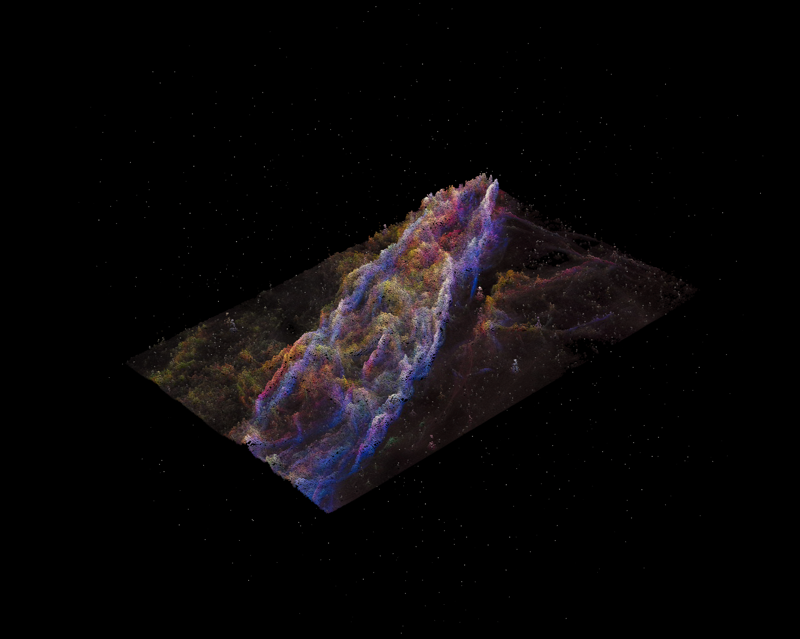
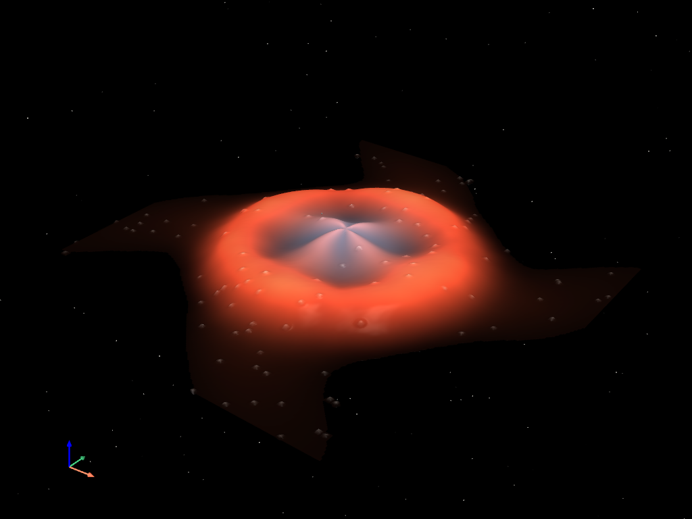
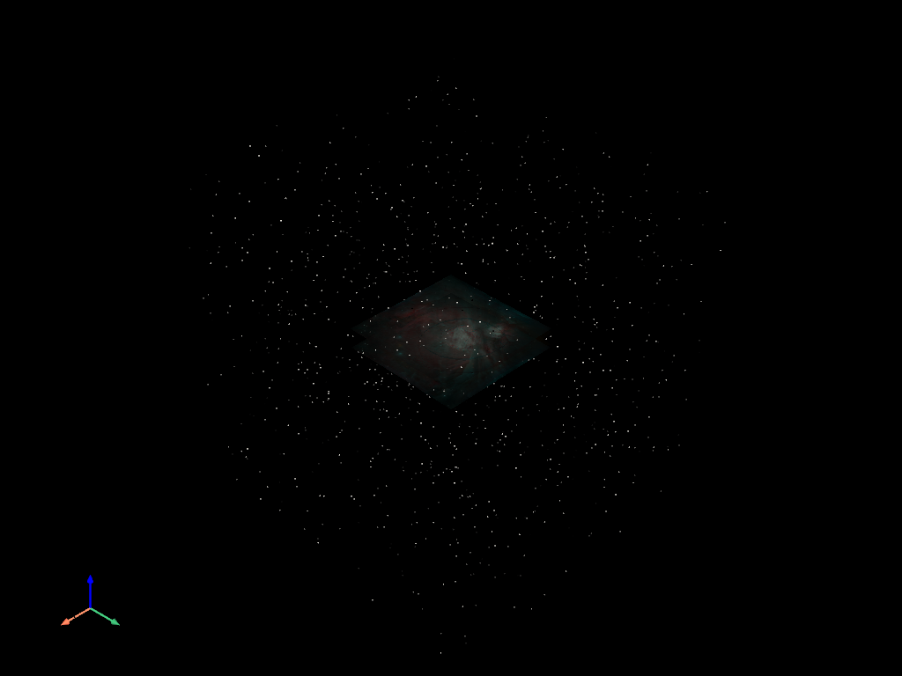
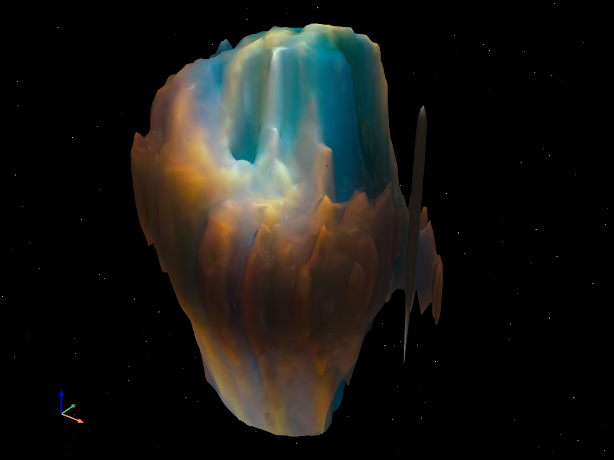
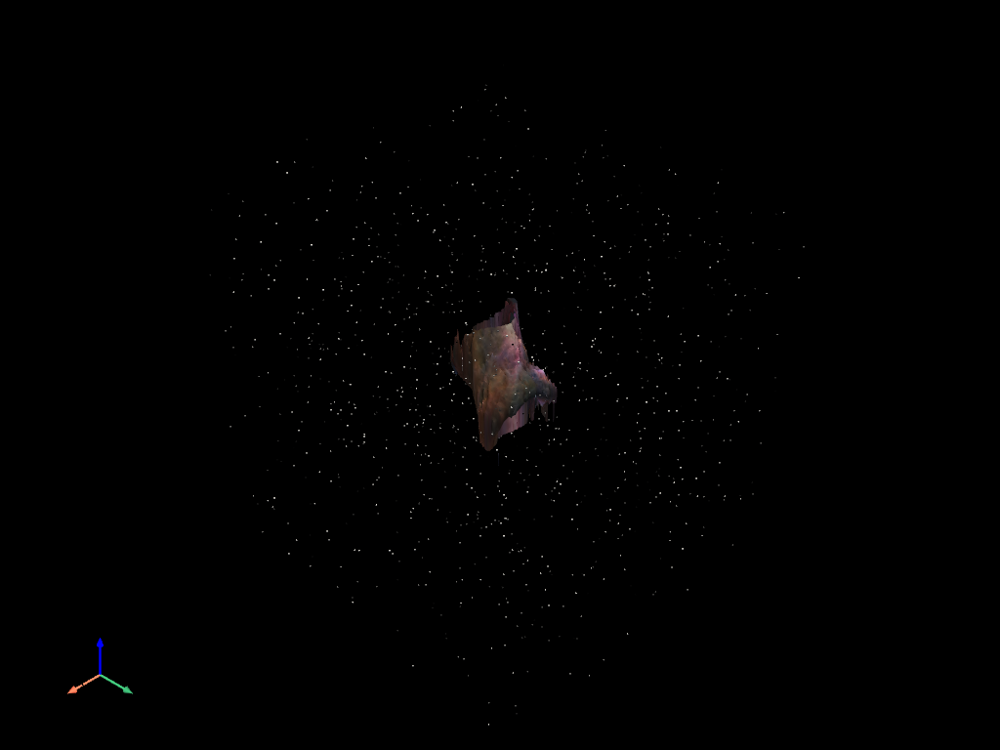
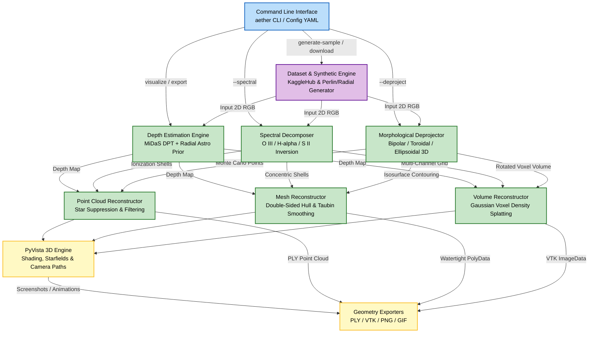
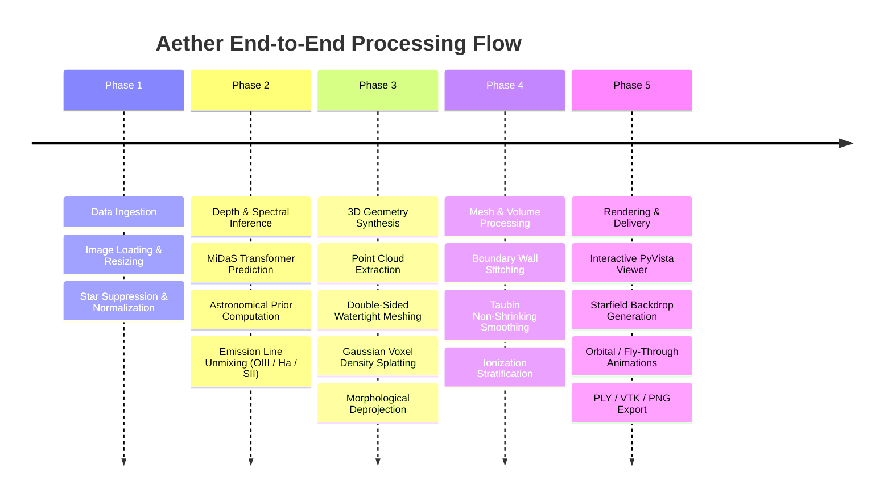

# Aether

Astrophysical 3D nebula reconstruction, spectral emission decomposition, and volumetric visualization from 2D astronomical imagery.

[](https://www.python.org/)
[](https://pytorch.org/)
[](https://docs.pyvista.org/)
[](LICENSE)
[](https://github.com/astral-sh/uv)


## Result

<p align="center">
  
</p>

<p align="center">
  
  
</p>

<p align="center">
  
  
</p>

## Description

**Aether** is an astrophysical visualization and reconstruction engine designed to infer, model, and render volumetric 3D structures of astronomical nebulae from single-exposure 2D telescope images (Hubble Space Telescope, JWST, or amateur astrophotography).

Recovering the three-dimensional geometry of diffuse, optically thin gas clouds from integrated line-of-sight surface brightness is a classic ill-posed inverse problem in astrophysics. Aether addresses this challenge through three unified modeling paradigms:

1. **Hybrid Monocular Depth Estimation**: Blends deep vision transformers (MiDaS / DPT) with an analytical astronomical prior based on center-of-mass barycentric radial shell models, separating diffuse gas volumes from sharp shock filaments.
2. **Spectral Emission Line Decomposition & Photoionization Stratification**: Chromatically unmixes raw multi-band imagery into physical emission channels ($[\text{O III}]$, $\text{H}\alpha$, $[\text{S II}]$) across multiple color profiles (Natural RGB, Hubble SHO, and HOO Bi-color), projecting them into concentric ionization shells that mirror Strömgren sphere thermodynamics.
3. **True 3D Morphological Deprojection**: Performs inverse coordinate modeling inspired by astronomical tools like SHAPE. It fits analytical 3D geometries (bipolar hourglass lobes, toroidal equatorial rings, and triaxial ellipsoids) through 3D Euler rotations (inclination and position angles) using Monte Carlo importance sampling.
4. **Cinematic PyVista Rendering Engine**: Generates interactive point clouds, watertight double-sided meshes with manifold boundary stitching and Taubin smoothing, and 3D voxel density grids (`pv.ImageData`) with custom opacity transfer functions and realistic background starfields.



## Instruction

Aether is managed using modern Python packaging with [`uv`](https://github.com/astral-sh/uv). You can set up your virtual environment, install dependencies, and run commands with high reproducibility.

### Prerequisites

- Python `>= 3.10`
- `uv` package manager ([installation instructions](https://docs.astral.sh/uv/getting-started/installation/))
- Optional: CUDA-capable GPU (NVIDIA) or Apple Silicon (Metal Performance Shaders / MPS) for accelerated neural depth inference.

### 1. Installation with uv

Clone the repository and sync the dependencies:

```bash
git clone https://github.com/0xS4cha/aether.git
cd aether
uv sync
```

Install editable CLI entry points into the environment:

```bash
uv pip install -e .
```

### 2. Verify the Test Suite

Run the full pytest suite to verify all mathematical transforms, geometry reconstructors, and rendering submodules:

```bash
uv run pytest
```

### 3. Docker Support

Aether provides a headless-capable container configured with OpenGL and VTK dependencies:

```bash
# Build the Docker image
make docker-build
# or: docker build -t aether:latest .

# Run a headless test rendering with output volume mounted
make docker-run
# or: docker run --rm -v $(PWD)/data:/app/data aether:latest visualize --sample --headless --screenshot data/outputs/docker_render.png
```

## Usage

Aether provides an intuitive CLI accessible via `uv run aether` (or the direct `aether` binary when your environment is activated).

### Command Line Interface

```bash
aether [command] [options]
```

Available subcommands:
- `visualize`: Reconstruct and render nebulae in 3D (interactive window, screenshots, or animated cinematics).
- `generate-sample`: Synthesize realistic 2D planetary nebula test imagery using radial gas simulations and Perlin turbulence.
- `export`: Process and export 3D geometry directly to `.ply`, `.vtk`, or `.png` files without displaying the GUI.
- `download`: Fetch astrophysical datasets via direct URL or KaggleHub.

---

### 1. Generate Synthetic Test Imagery

Generate a high-resolution synthetic planetary nebula featuring central core emission, turbulent gaseous shock rings, and foreground starfields:

```bash
uv run aether generate-sample --output data/samples/sample_nebula.png --width 512 --height 512 --seed 42
```

---

### 2. Interactive 3D Visualization

Reconstruct and inspect a nebula in 3D using point clouds, meshes, or volumetric voxel splats:

**Point Cloud Mode (Default):**
```bash
uv run aether visualize --sample --rep point_cloud
```

**Double-Sided Watertight Mesh Mode:**
```bash
uv run aether visualize --image data/samples/sample_nebula.png --rep mesh --scale 40.0 --threshold 0.04
```

**Volumetric Voxel Splatting:**
```bash
uv run aether visualize --sample --rep volume
```

---

### 3. Spectral Emission Line Decomposition

Decompose astronomical images into narrow-band ionization regimes ($[\text{O III}]$, $\text{H}\alpha$, $[\text{S II}]$) and render them as nested physical shells:

**Hubble SHO Palette (Sulfur II, Hydrogen-alpha, Oxygen III):**
```bash
uv run aether visualize --image data/samples/sample_nebula.png --rep mesh --spectral --spectral-mode hubble_sho
```

**HOO Bi-Color Palette (Hydrogen & Oxygen):**
```bash
uv run aether visualize --image data/samples/sample_nebula.png --rep point_cloud --spectral --spectral-mode hoo_bicolor
```

**Natural RGB Inversion:**
```bash
uv run aether visualize --sample --rep point_cloud --spectral --spectral-mode natural_rgb
```

---

### 4. True 3D Morphological Deprojection

Perform 3D coordinate deprojection using analytical geometry models tilted in space:

**Bipolar Hourglass Nebula ($45^\circ$ inclination, $15^\circ$ position angle):**
```bash
uv run aether visualize --sample --deproject --morphology bipolar --inclination 45.0 --pa 15.0 --rep point_cloud
```

**Toroidal Equatorial Ring ($30^\circ$ inclination):**
```bash
uv run aether visualize --sample --deproject --morphology toroidal --inclination 30.0 --rep mesh
```

**Triaxial Ellipsoidal Bubble ($60^\circ$ inclination):**
```bash
uv run aether visualize --sample --deproject --morphology ellipsoidal --inclination 60.0 --rep volume
```

---

### 5. Headless Rendering & Cinematic Animations

Render 360-degree orbital trajectories or camera fly-throughs into animated `.gif` files without opening a window:

**Orbital 360° Rotation GIF:**
```bash
uv run aether visualize --sample --rep mesh --cinematic data/outputs/nebula_orbit.gif --cinematic-mode orbit
```

**Fly-Through Trajectory:**
```bash
uv run aether visualize --sample --rep point_cloud --cinematic data/outputs/nebula_fly.gif --cinematic-mode fly_through
```

**Off-Screen Headless Screenshot:**
```bash
uv run aether visualize --image data/samples/sample_nebula.png --rep mesh --headless --screenshot data/outputs/render.png
```

---

### 6. Exporting 3D Geometry

Export reconstructed geometries to standard 3D formats (`.ply`, `.vtk`, `.vti`) compatible with Blender, MeshLab, or Unreal Engine:

```bash
# Export point cloud to PLY
uv run aether export --image data/samples/sample_nebula.png --rep point_cloud --output data/outputs/nebula.ply

# Export double-sided mesh to PLY
uv run aether export --image data/samples/sample_nebula.png --rep mesh --scale 45.0 --output data/outputs/nebula_mesh.ply

# Export true 3D deprojected morphology
uv run aether export --sample --deproject --morphology bipolar --rep mesh --output data/outputs/bipolar_mesh.ply
```

---

### 7. Downloading Real Datasets

Download planetary nebula or deep-sky survey catalogs via direct URL or Kaggle:

```bash
# Download via KaggleHub
uv run aether download --kagglehub "username/planetary-nebulae-dataset" --dest data/dataset

# Or using the dedicated dataset CLI
uv run aether-dataset --generate-sample --sample-output data/samples/demo.png
```

---

### 8. Configuration File Support

Override any default parameter using a YAML configuration file (`config/default.yaml`):

```bash
uv run aether visualize --config config/default.yaml --sample
```

Example snippet from `config/default.yaml`:
```yaml
device: "auto"

depth:
  model_type: "hybrid"
  astronomical_radial_weight: 0.4
  astronomical_power: 1.5

geometry:
  representation: "mesh"
  mesh:
    depth_scale: 40.0
    resolution_scale: 0.5
    smooth_iterations: 15
    double_sided: true
    close_mesh: true
    taper_edges: true

spectral:
  enabled: true
  mode: "hubble_sho"
  oiii_radius: 0.65
  ha_radius: 1.00
  sii_radius: 1.25
```

---

### 9. Python API Usage

Aether can be integrated into custom scientific workflows:

```python
from aether.config import load_config
from aether.pipeline import NebulaPipeline

# 1. Initialize configuration and pipeline
config = load_config("config/default.yaml")
config.spectral.enabled = True
config.geometry.representation = "mesh"

pipeline = NebulaPipeline(config)

# 2. Process 2D image into 3D representation
result = pipeline.process(
    "data/samples/sample_nebula.png",
    representation="mesh",
    spectral=True,
)

# 3. Export and display
pipeline.export(result, "data/outputs/my_nebula.ply")
pipeline.render(result, show=True)
```

## Algorithms

Aether implements an end-to-end scientific pipeline tailored to the unique physics of astronomical nebulae:

### 1. Hybrid Depth Estimation

Observational astrophotography contains both smooth, diffuse gas envelopes and high-frequency shock ionization fronts. Standard monocular depth networks (trained on indoor or terrestrial outdoor scenes) often fail on transparent gas clouds. Aether resolves this with a dual-branch hybrid estimator:

- **Astronomical Radial Prior**: Calculates the center-of-mass barycenter $(\bar{x}, \bar{y})$ of luminous flux and constructs an ellipsoidal shell envelope:
  $$z_{\text{shell}}(r) = \sqrt{\max\left(0, R_{\max}^2 - r^2\right)}$$
  Combined with multi-scale Gaussian bandpass separation, this preserves both central core volume and delicate filamentary ionization details.
- **Deep Monocular Inversion (MiDaS / DPT)**: Employs Vision Transformers (`MiDaS_small`, `DPT_Hybrid`, `DPT_Large`) to extract relative depth gradients and non-local structural cues.
- **Bayesian Blending**: Adaptively combines the neural depth field $D_{\text{nn}}$ and astronomical prior $D_{\text{astro}}$:
  $$D_{\text{hybrid}} = (1 - w_{\text{astro}}) D_{\text{nn}} + w_{\text{astro}} D_{\text{astro}}$$

### 2. Spectral Decomposition & Photoionization Stratification

In planetary nebulae and H II regions, ultraviolet radiation from a central white dwarf or O/B star ionizes surrounding gas in concentric layers governed by ionization potentials:
- $[\text{O III}]$ ($500.7\text{ nm}$, high-excitation inner core, $h\nu > 35.1\text{ eV}$)
- $\text{H}\alpha$ ($656.3\text{ nm}$, recombination hydrogen shell, $h\nu > 13.6\text{ eV}$)
- $[\text{S II}]$ ($671.6/673.1\text{ nm}$, outer shock boundary, $h\nu > 10.4\text{ eV}$)

Aether unmixes these emission regimes from multi-band color spaces (Natural RGB, Hubble SHO, HOO) using matrix decomposition and chromatic shock filters, assigning each species an intrinsic spatial radial factor ($r_{[\text{O III}]} < r_{\text{H}\alpha} < r_{[\text{S II}]}$) to generate nested 3D concentric shells.

### 3. True 3D Morphological Deprojection

For axisymmetric or bilaterally symmetric nebulae, Aether performs full 3D inverse modeling:
- **Intrinsic Rotation Matrix**: Transforms observer coordinates $(x, y, z)$ into intrinsic source coordinates $(x', y', z')$ via Euler rotation parameterized by Inclination ($i$) and Position Angle ($PA$):
  $$R = R_z(PA) \cdot R_x(i)$$
- **Analytical Geometries**:
  - *Bipolar Model*: Flaring lobes parameterized by waist radius $r_0$, expansion factor $\alpha$, and power exponent $\gamma$:
    $$r(z') = r_0 \left(1 + \alpha |z'|^\gamma\right)$$
  - *Toroidal Model*: Ring torus geometry with major radius $R$, minor radius $r$, and axial compression $\beta$:
    $$d = \sqrt{(r_\perp - R)^2 + (z' / \beta)^2}$$
  - *Triaxial Ellipsoid*: Scaled semi-axes $(a, b, c)$ generating volumetric spheroidal shells.
- **Monte Carlo Importance Sampling**: Distributes candidate points across the 3D volume, weighting selection probabilities by the product of model density and line-of-sight image brightness:
  $$P(x, y, z) \propto \rho(x', y', z') \cdot I(u, v)^{0.75}$$

### 4. Watertight Double-Sided Mesh Generation

Aether's surface reconstructor converts planar depth maps into fully enclosed 3D manifold volumes:
- **Foreground Star Suppression**: Median filtering and brightness disparity masking remove star puncture artifacts.
- **Edge Tapering**: Cosine easing smoothly pinches boundary edges to zero depth at flux thresholds.
- **Enclosed Manifold Stitching**: Generates symmetric front and rear shells, then stitches boundary perimeter edges with vertical quadrilateral walls (`close_mesh`).
- **Taubin Volume-Preserving Smoothing**: Eliminates high-frequency noise and discretization staircasing without shrinking the mesh volume.



## Project Structure

```
aether/
├── assets/                  # Demonstration previews, renders, and orbit GIF animations
├── config/
│   └── default.yaml         # Default hyperparameters (depth, mesh, spectral, rendering)
├── data/
│   ├── dataset/             # Downloaded nebula catalogs and archives
│   ├── outputs/             # Generated renders, meshes, PLY files, and GIF animations
│   └── samples/             # Synthetic and reference nebula test images
├── src/
│   └── aether/
│       ├── __init__.py      # Package export interface and version info
│       ├── __main__.py      # Primary CLI entry point (argparse dispatch)
│       ├── config.py        # Strongly-typed dataclass configurations and YAML loader
│       ├── pipeline.py      # Core orchestration pipeline (NebulaPipeline)
│       ├── depth/           # Depth estimation subpackage
│       │   ├── astronomical.py  # Analytical radial shell & barycenter depth estimator
│       │   ├── base.py          # Abstract base estimator and normalization utilities
│       │   ├── ensemble.py      # Hybrid Bayesian blending (MiDaS + Astronomical)
│       │   └── midas.py         # Torch Hub MiDaS / DPT Vision Transformer wrapper
│       ├── geometry/        # 3D spatial representation subpackage
│       │   ├── mesh.py          # Double-sided manifold meshing & boundary stitching
│       │   ├── point_cloud.py   # Subsampled 3D point cloud reconstructor
│       │   └── volume.py        # Volumetric 3D voxel density splatting (pv.ImageData)
│       ├── io/              # Input/output and data utilities
│       │   ├── dataset.py       # KaggleHub / URL downloader and synthetic nebula generator
│       │   ├── exporters.py     # PLY, VTK, VTI, and 16-bit depth exporters
│       │   └── image.py         # Image loading, resizing, star removal, and color utilities
│       ├── morphology/      # True 3D deprojection & kinematics subpackage
│       │   ├── cinematics.py    # Camera trajectories (orbit, fly-through) and GIF recorder
│       │   ├── deprojector.py   # Monte Carlo importance sampling & isosurface contouring
│       │   └── models.py        # Bipolar, Toroidal, and Ellipsoidal 3D mathematical models
│       ├── rendering/       # PyVista rendering and visualization engine
│       │   ├── palettes.py      # Transfer functions, colormaps, and opacity curves
│       │   └── visualizer.py    # NebulaVisualizer: lighting, meshes, volumes, starfields
│       └── spectral/        # Spectral astrophysics subpackage
│           ├── decomposer.py    # Multi-band chromatic unmixing (SHO, HOO, Natural RGB)
│           ├── ionization.py    # Physical photoionization stratification models
│           └── reconstructor.py # Concentric shell and multi-channel spectral reconstructor
├── tests/                   # Pytest test suite (36 passing tests)
│   ├── test_depth.py        # Depth estimator unit tests
│   ├── test_geometry.py     # Mesh, point cloud, and volume geometry tests
│   ├── test_io.py           # Image and export unit tests
│   ├── test_morphology.py   # Analytical models and deprojection tests
│   ├── test_pipeline.py     # End-to-end integration tests
│   └── test_spectral.py     # Spectral decomposition and ionization tests
├── dockerfile               # Container build with headless OpenGL / VTK support
├── example.md               # Reference documentation template
├── Makefile                 # Development automation shortcuts
├── pyproject.toml           # Project metadata, dependencies, and CLI console scripts
└── uv.lock                  # Pinned dependency lockfile
```

## Resources

- [PyVista](https://docs.pyvista.org/) — 3D mesh analysis and VTK visualization engine.
- [PyTorch](https://pytorch.org/) — Deep learning framework powering neural depth estimation.
- [MiDaS](https://github.com/isl-org/MiDaS) — Vision Transformers for robust monocular relative depth estimation (Intel ISL).
- [SHAPE](http://bufador.astrosen.unam.mx/shape/) — Astrophysical modeling tool for morpho-kinematic reconstruction of gaseous nebulae.
- [NASA / ADS Astrophysics Data System](https://ui.adsabs.harvard.edu/) — Astrophysical literature on Strömgren spheres, planetary nebulae kinematics, and ionization fronts.
- [KaggleHub](https://github.com/Kaggle/kagglehub) — Automated dataset acquisition from the Kaggle ecosystem.
- [uv](https://docs.astral.sh/uv/) — Extremely fast Python package and project manager.

## Disclaimer

⚠️ IMPORTANT — Scientific and Educational Use:
- Aether reconstructs 3D representations of astrophysical objects from single 2D projection angles. In observational astrophysics, line-of-sight depth reconstruction from single-view imaging is inherently an under-constrained inverse problem.
- While the models incorporate physical priors (photoionization stratification, axisymmetric lobe geometry, and Stromgren radial envelopes), generated reconstructions represent plausible morpho-kinematic visualizations rather than certified volumetric astrometric measurements.
- For research requiring kinematic Doppler velocities, pair Aether's geometric priors with high-resolution echelle spectrography (e.g., Keck, VLT, or ESO survey data).

## Feedback

Contributions, suggestions, and issue reports are welcome! If you encounter a bug, have ideas for new astrophysical models, or want to contribute enhancements:
- Open an issue on GitHub: [Issues](https://github.com/0xS4cha/aether/issues)
- Submit a pull request with new morphology models, spectral presets, or rendering shaders.
